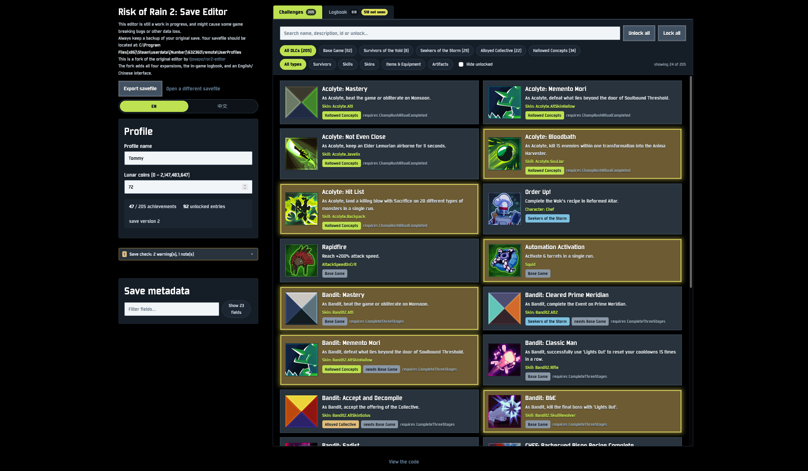
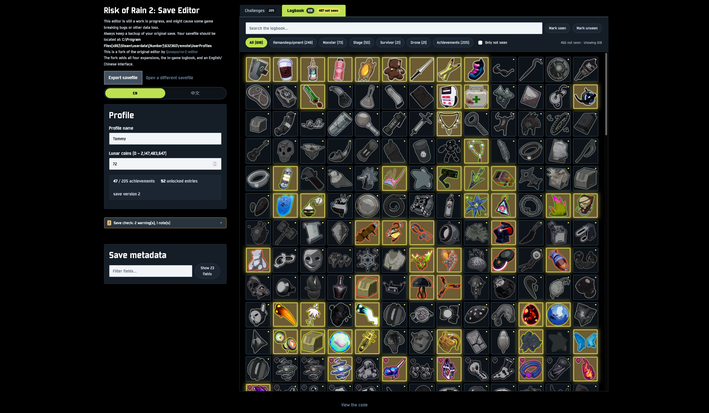

<p align="center">
  
</p>

<h1 align="center">ror2-editor</h1>

<p align="center">
  <strong>一个可以完整自定义《雨中冒险 2》存档的网页应用。</strong>
</p>

<p align="center">
  <a href="https://comeixalpha.github.io/ror2-editor/index.html">
    
  </a>
  <a href="https://github.com/ComeixAlpha/ror2-editor/stargazers">
    
  </a>
  <a href="https://github.com/ComeixAlpha/ror2-editor/commits/main">
    
  </a>
</p>

<p align="center">
  
  
  
  
  
</p>

<p align="center">
  
  
  
  
</p>

<p align="center">
  <a href="./README.md">English</a> · <a href="./README.zh-CN.md">中文</a>
</p>

## 界面截图

| 挑战 | 日志 |
| :---: | :---: |
|  |  |

## 在线使用

**<https://comeixalpha.github.io/ror2-editor/index.html>**

作为 [comeixalpha.github.io](https://comeixalpha.github.io/) 的一部分托管 —— 也可以按下面的说明从源码自行构建。

## 关于本分支

本项目是 [tjosepo/ror2-editor](https://github.com/tjosepo/ror2-editor) 的分支，原作是那个编辑器。原始应用的一切功劳都归于该仓库；本分支的职责是承载下面这些功能。

本分支在原版之上新增的内容：

- 支持本体加上全部四个扩展包 —— **虚空幸存者**、**风暴探寻者**、**合金集合体** 与 **万象归衡** —— 共 205 个成就。
- 日志标签页，与游戏内日志一致：游戏原图、游戏原顺序，以及每个物品真实的功能描述。
- 中英文双语界面，游戏内容一律采用游戏自带的翻译。
- 依据游戏反序列化器推导出的存档校验，与其静默写入一个会被游戏拒绝的档案，不如把它解释清楚。

本仓库是源码。在线版本由 [comeixalpha.github.io](https://github.com/ComeixAlpha/comeixalpha.github.io) 这个 Pages 站点发布，它的构建流程会检出本仓库并挂载到 `/ror2-editor/`，因此线上版本始终跟随本仓库的 `main`。

应用本身不发起任何网络请求：读取、编辑、导出档案全部在浏览器内完成，存档不会离开你的机器。

## 本地构建

本项目使用 [pnpm](https://pnpm.io/)。pnpm 10 及以后，大部分设置放在 `pnpm-workspace.yaml` 而不是 `.npmrc`。

```
pnpm install
pnpm build
```

启动开发服务器：

```
pnpm dev
```

运行测试：

```
pnpm test
```

## 部署到子路径

`pnpm build` 产出的是根路径相对的资源，这正是 `pnpm dev` 和部署在根路径时想要的。若要挂在子路径下，需要传入 base：

```
pnpm build --base=/ror2-editor/
```

[ComeixAlpha 的 Pages 站点](https://github.com/ComeixAlpha/comeixalpha.github.io) 就是以这种方式提供编辑器的：它的构建流程检出本仓库、带上该参数构建，再把产物放进自己的 `public/` 目录。入口是显式的 `/ror2-editor/index.html` 而非裸目录 —— 原因见该仓库 `src/lib/shared.ts` 里的说明。

Vite 会重写它自己生成的路径，但不会重写本应用手写的那部分 —— 图标与日志图片的 URL。那些路径走 `import.meta.env.BASE_URL`（见 `src/lib/public-url.ts`），因此会跟随同一个前缀，而不是去解析到域名根目录。

`pnpm install` 需要执行 `esbuild` 的安装脚本。它已在 `pnpm-workspace.yaml` 中放行；否则 vite 找不到自己的 esbuild 二进制文件。如果你在代理后面：Node 不读取 Windows 系统代理 —— 请设置 `HTTPS_PROXY`/`HTTP_PROXY`，或取消 `.npmrc` 里 `proxy` 两行的注释。

## 游戏数据从哪来

编辑器**不**使用手写的表格。`src/data/generated/` 下的一切都是从一份已安装的游戏里提取出来的。

提取结果已提交进仓库，因此构建应用本身不需要安装游戏。它涵盖成就及其图标、日志 —— 全部 618 条及其配图与每个物品的功能描述 —— 以及装备外观。

## 存档是如何写出的

只有编辑器管理的那些节点会被改动。档案中其余每一个元素、属性和 token 都逐字节原样带过，因此来自更新版本游戏的存档在编辑后依然可用，而不会被悄悄裁剪。`tests/xml.test.mjs` 在一个真实的 552 KB 档案上断言了逐字节一致的往返。

成就与解锁项是两个独立的列表：授予一个成就时，会把 id 写进 `<achievementsList>`，**同时**把奖励字符串写进 `<stats><unlock>` —— 因为只写成就本身在游戏里没有任何效果。
